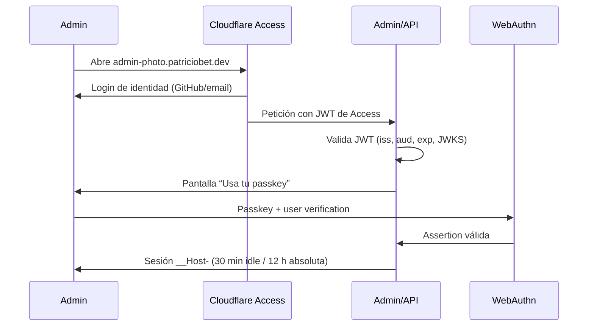
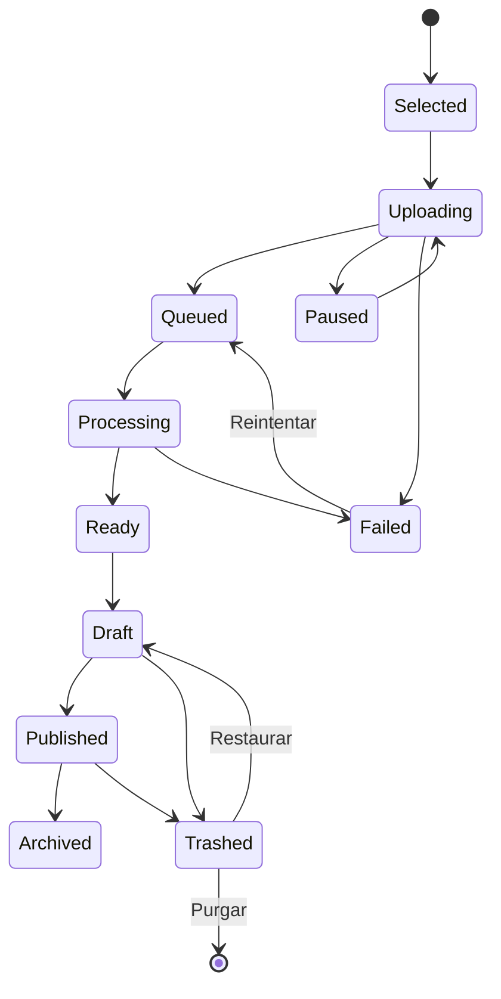

# Flujo del administrador

**Actor:** Patricio (único admin).
**Origen:** `https://admin-photo.patriciobet.dev` (Access + passkey).
**Objetivo:** subir, organizar, publicar y recuperar contenido sin tocar código y
sin dejar estados a medias, incluso tras un apagón.

---

## 1. Acceso



**Reglas:**

- Sin Access o sin passkey no hay acceso; no existe bypass.
- No hay contraseñas, registro público ni “olvidé mi contraseña”.
- La sesión se revoca en el servidor al cerrar.
- Acciones destructivas piden reautenticación < 5 min.
- Cada intento fallido se registra y alerta si se repite.

**Errores:**

| Situación | Mensaje | Acción |
|---|---|---|
| Access deniega | “No autorizado”. | Sin detalles; revisar identidad. |
| JWT inválido/expirado | “Sesión de Access inválida”. | Reautenticar en Access. |
| Passkey no reconocida | “No pudimos verificar tu passkey”. | Reintentar o usar recovery code. |
| Sesión expirada | “Tu sesión expiró”. | Volver a entrar. |
| Rate limit | “Demasiados intentos”. | Esperar; alerta. |

---

## 2. Onboarding con el sitio vacío

Al entrar por primera vez:

```text
Bienvenido. El sitio ya funciona sin contenido.
[1] Configura tu passkey de respaldo
[2] Revisa que el backup esté activo
[3] Sube tu primera foto
[4] Crea una colección
[5] Publica cuando estés listo
```

- Cada paso enlaza a la pantalla correspondiente.
- Se puede omitir y volver después.
- El dashboard muestra el estado: “0 fotos, 0 videos, 0 colecciones”.
- No se fuerza a publicar nada para usar el admin.

---

## 3. Subida de fotos

```text
→ /media/new
⇒ Zona de arrastrar/soltar + selector + pegar
→ Selecciona hasta 20 archivos
⇒ Validación previa (tipo/tamaño); previews locales
→ Inicia subida
⇒ Por archivo: URL firmada → R2 incoming/ (multipart si > 100 MB)
⇒ Progreso por archivo; pausar/reanudar/cancelar
⇒ Job en cola → procesando → listo o error
→ Revisa metadatos y publicación
```

**Estados por archivo:**



**Reglas:**

- La validación del cliente es una ayuda, no la verdadera.
- El servidor valida firma, dimensiones, píxeles, duración y códecs.
- Reintentar no duplica: clave de idempotencia por archivo.
- Si se cierra el navegador, al volver se ofrece reanudar o descartar.
- Si el servidor se reinicia, la sesión y las partes persisten.
- Un archivo huérfano se limpia a las 24 h.

**Errores:**

| Error | Mensaje | Acción |
|---|---|---|
| Tipo no permitido | “Formato no compatible”. | Convertir a JPEG/PNG/WebP/MP4. |
| > 50 MB foto / 2 GB video | “Archivo demasiado grande”. | Reducir o dividir. |
| > 200 MP / > 4K / > 10 min | “Excede el límite”. | Redimensionar/recortar. |
| Duplicado | “Ya existe un archivo igual”. | Continuar o cancelar. |
| R2 caído | “Almacenamiento no disponible”. | Reintentar; no se pierde el original. |
| Job fallido | Causa + `traceId`. | Reintentar o corregir. |
| Apagón | Job `interrupted`. | Reconciliación y reintento. |

---

## 4. Metadatos y organización

```text
→ /media/{id}
⇒ Preview + campos ES/EN
→ Título, alt, descripción, slug, fecha, colección, etiquetas, licencia,
   crédito, focal point, destacado, orden
→ Guardar
⇒ Versión optimista; si otra pestaña cambió, aviso y no se pisa
→ Edición por lotes
⇒ Aplica a selección; transaccional
→ Reordenar
⇒ Arrastrar o botones accesibles; guarda orden
```

**Validaciones:**

- Título y alt ES obligatorios para publicar.
- Si tendrá EN, título/alt/descripción/slug EN obligatorios.
- Slug único por idioma; al cambiarlo se crea redirect 301.
- Focal point normalizado 0–1; se usa en miniaturas y OG.
- GPS nunca se guarda ni se publica.
- Se puede marcar `is_demo` y registrar procedencia/licencia.

---

## 5. Publicación

```text
→ “Publicar”
⇒ Validación: procesado listo, metadatos, slug, colección
⇒ Estado “publicado” + build en cola
⇒ Builder genera release
⇒ current cambia atómicamente al final
⇒ Purga de caché + sitemap/RSS actualizados
⇒ “Publicado en 1 min 42 s” + enlace a la versión viva
```

**Reglas:**

- Cambios en 60 s se agrupan en un solo build.
- Si el build falla, `current` no cambia y la release anterior sigue viva.
- El admin muestra logs seguros y `traceId`.
- Rollback a una de las 3 últimas releases con confirmación.
- Despublicar retira de listados, sitemap, RSS y búsqueda.
- Borrar va a papelera 30 días; purgar exige reauth.
- Publicar con 0 medios es válido.

**Errores:**

| Error | Mensaje | Acción |
|---|---|---|
| Falta alt/título | “Completa los campos obligatorios”. | Enlaza al campo. |
| Slug duplicado | “Ese slug ya existe”. | Sugiere otro. |
| Build falla | “No se publicó; la versión actual sigue viva”. | Ver logs, corregir, reintentar. |
| R2 caído | “Faltan variantes”. | Reintentar cuando vuelva. |
| Disco lleno | “Sin espacio para la release”. | Limpiar/prune; alerta. |

---

## 6. Reproceso

```text
→ Selecciona uno o varios
→ “Reprocesar”
⇒ Job idempotente con nueva versión de variantes
⇒ Las URLs actuales siguen funcionando hasta que el nuevo set esté completo
⇒ Al terminar, se actualiza la referencia de forma atómica
```

- No se cambia el original.
- No se pierde la versión publicada si falla.
- Se registra el motivo y el actor.

---

## 7. Carga y descarga de demo

```text
→ Ajustes → “Contenido demo”
→ “Cargar demo”
⇒ Confirmación: “Se crearán N elementos marcados como demo”
⇒ Pipeline normal + is_demo=true + procedencia
→ “Descargar demo”
⇒ Confirmación: “Se eliminarán solo los demo”
⇒ El sitio vuelve al estado vacío si no hay reales
```

- No toca contenido real.
- No se atribuye al autor.
- Se puede ejecutar en desarrollo/staging sin producción.

---

## 8. Dashboard y estado

| Tarjeta | Contenido | Alerta |
|---|---|---|
| Contenido | Fotos/videos publicados, borradores, papelera. | — |
| Jobs | En cola, procesando, fallidos, más antiguo. | Cola atascada > 30 min. |
| Build | Último build, duración, estado. | Fallo o > 10 min. |
| Release | Versión viva, anteriores, rollback. | Sin release válida. |
| Backup | Última copia, tamaño, resultado. | > 24 h o fallo. |
| Disco | Uso local y R2. | > 80 %. |
| Seguridad | Sesiones, passkeys, intentos fallidos. | Login fallido repetido. |

---

## 9. Auditoría

- Append-only: acción, objeto, fecha, IP truncada/hasheada, UA, actor.
- Filtros por fecha, acción y objeto.
- Exportación JSON/CSV.
- Solo lectura; no se puede editar ni borrar desde el admin.
- Retención 1 año.

---

## 10. Concurrencia y múltiples pestañas

- Cada recurso tiene `version`.
- Al guardar se envía la versión leída.
- Si cambió, el guardado falla con aviso y muestra los cambios.
- El usuario decide recargar o sobrescribir de forma explícita.
- Nunca se pierde el cambio de la otra pestaña en silencio.

---

## 11. Recuperación

### Pérdida de passkey

```text
→ “Usar código de recuperación”
⇒ Código de un solo uso (argon2id)
⇒ Acceso temporal
→ Registrar nueva passkey
→ Revocar la passkey perdida
→ Regenerar códigos de recuperación
```

### Pérdida de acceso a Access

- La identidad de respaldo (si está configurada) entra por Access.
- Si no, se accede físicamente al servidor o por red local controlada.
- Se revisa el login y se revoca la sesión comprometida.

### Sesión comprometida

1. “Cerrar todas las sesiones”.
2. Revocar passkey afectada.
3. Regenerar recovery codes.
4. Revisar auditoría.
5. Rotar secretos si aplica.
6. Documentar incidente.

---

## 12. Apagón durante una operación

| Momento | Al volver |
|---|---|
| Subida multiparte | Se ofrece reanudar; partes huérfanas se limpian. |
| Job `processing` | Se marca `interrupted` y se reencola o falla con causa. |
| Build | `current` intacto; el build se marca fallido. |
| Migración | Backup previo; se restaura si quedó a medias. |
| Backup | Se reintenta; alerta si falla dos veces. |
| Sesión | Persistida; el admin vuelve a entrar si expiró. |

---

## 13. Criterios de aceptación

- [ ] AC-07: upload interrumpido.
- [ ] AC-08: apagón durante procesamiento.
- [ ] AC-09: apagón durante build.
- [ ] AC-10: rollback.
- [ ] AC-11: despublicar.
- [ ] AC-12: login sin Access/passkey.
- [ ] AC-13: JWT inválido.
- [ ] AC-14: sesión expirada.
- [ ] AC-15: pérdida de passkey.
- [ ] AC-19: upload malicioso.
- [ ] AC-35: admin móvil.
- [ ] AC-39: assets demo.
