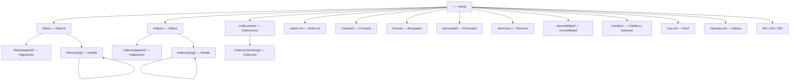
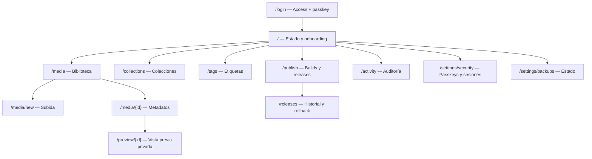

# Sitemap y arquitectura de información

**Estado:** borrador para aprobación
**Fase:** 01 — UX
**Fecha:** 17 de noviembre de 2026
**Fuente:** [`SRS v1.1`](../00-gestion/srs-v1.1.md)

---

## 1. Principios

- La foto y el video son el centro; la navegación es discreta.
- Cada vista tiene una URL real, compartible e indexable cuando corresponde.
- ES es el idioma principal; EN es una réplica completa, no una traducción
  automática visible.
- El sitio se entiende sin JavaScript: enlaces `<a>`, formularios y contenido.
- El estado vacío es una vista de primera clase, no un error.
- El admin vive en otro origen y no se enlaza desde el sitio público.

---

## 2. Mapa del sitio público (ES)



### 2.1 Rutas ES

| Ruta | Plantilla | Indexable | En sitemap | Notas |
|---|---|---|---|---|
| `/` | Home | sí | sí | Hero, destacados, colecciones, reel, about, contacto. |
| `/fotos/` | Galería | sí | sí | Introducción editorial + cuadrícula + paginación. |
| `/fotos/pagina/{n}/` | Galería paginada | sí | sí | 36 por página; página 1 canónica en `/fotos/`. |
| `/fotos/{slug}/` | Detalle de foto | sí | sí | Lightbox, ficha, relacionados, licencia. |
| `/videos/` | Galería de video | sí | sí | Introducción + cuadrícula + paginación. |
| `/videos/pagina/{n}/` | Galería paginada | sí | sí | 36 por página. |
| `/videos/{slug}/` | Detalle de video | sí | sí | Reproductor, poster, ficha, transcripción. |
| `/colecciones/` | Listado de colecciones | sí | sí | Tarjetas con portada y conteo. |
| `/colecciones/{slug}/` | Detalle de colección | sí | sí | Descripción + cuadrícula. |
| `/etiquetas/{slug}/` | Etiqueta | condicional | condicional | `noindex,follow` con menos de 8 elementos. |
| `/buscar/` | Búsqueda | no | no | `noindex,follow`; Pagefind en cliente. |
| `/sobre-mi/` | Sobre mí | sí | sí | Bio, retrato, enfoque, enlaces. |
| `/contacto/` | Contacto | sí | sí | Formulario + alternativa. |
| `/privacidad/` | Privacidad | sí | sí | Legal. |
| `/terminos/` | Términos | sí | sí | Legal. |
| `/accesibilidad/` | Accesibilidad | sí | sí | Declaración y limitaciones. |
| `/creditos/` | Créditos | sí | sí | Licencias, assets demo, atribuciones. |
| `/404/` | Error 404 | no | no | Código 404 real; navegación útil. |
| `/410/` | Contenido retirado | no | no | Código 410 real. |
| `/503/` | Mantenimiento | no | no | `Retry-After`. |
| `/rss.xml` | Feed | — | — | Últimos publicados. |
| `/sitemap.xml` | Índice de sitemaps | — | — | Páginas, imágenes y videos. |
| `/robots.txt` | Robots | — | — | Sitemap; sin admin. |

### 2.2 Rutas EN

| Ruta ES | Ruta EN |
|---|---|
| `/` | `/en/` |
| `/fotos/` | `/en/photos/` |
| `/fotos/pagina/{n}/` | `/en/photos/page/{n}/` |
| `/fotos/{slug}/` | `/en/photos/{slug}/` |
| `/videos/` | `/en/videos/` |
| `/videos/pagina/{n}/` | `/en/videos/page/{n}/` |
| `/videos/{slug}/` | `/en/videos/{slug}/` |
| `/colecciones/` | `/en/collections/` |
| `/colecciones/{slug}/` | `/en/collections/{slug}/` |
| `/etiquetas/{slug}/` | `/en/tags/{slug}/` |
| `/buscar/` | `/en/search/` |
| `/sobre-mi/` | `/en/about/` |
| `/contacto/` | `/en/contact/` |
| `/privacidad/` | `/en/privacy/` |
| `/terminos/` | `/en/terms/` |
| `/accesibilidad/` | `/en/accessibility/` |
| `/creditos/` | `/en/credits/` |
| `/rss.xml` | `/en/rss.xml` |

Los slugs de contenido se traducen por elemento. Si un elemento no tiene EN
completo, su página EN no se genera ni entra en hreflang.

---

## 3. Navegación

### 3.1 Cabecera

| Elemento | Comportamiento |
|---|---|
| Logo PB | Enlace a `/`; `aria-label` “Patricio Betancourt, inicio”. |
| Fotos | Enlace a `/fotos/`; `aria-current="page"` en la sección. |
| Videos | Enlace a `/videos/`. |
| Colecciones | Enlace a `/colecciones/`. |
| Sobre mí | Enlace a `/sobre-mi/`. |
| Contacto | Enlace a `/contacto/`. |
| ES / EN | Enlace a la página equivalente; si no existe, no se muestra como enlace. |
| Tema | Botón claro/oscuro/sistema; guarda preferencia sin cookies. |
| Menú móvil | `<dialog>` o panel accesible; foco atrapado; cierra con Esc. |

La cabecera es fija pero no tapa el foco ni el contenido al navegar por teclado.
En móvil se reduce a logo, menú y tema.

### 3.2 Pie

- Navegación secundaria: Fotos, Videos, Colecciones, Sobre mí, Contacto.
- Legal: Privacidad, Términos, Accesibilidad, Créditos.
- Feed RSS.
- Portfolio de desarrollo: `https://patriciobet.dev`.
- GitHub y LinkedIn.
- Copyright y licencia.
- “Sitio autoalojado” (opcional, discreto).

### 3.3 Migas de pan

En detalle de foto/video y colección:

```text
Inicio / Fotos / Colección / Título
```

En la versión EN se traducen los segmentos visibles, no las URLs.

---

## 4. Plantillas y secciones

### 4.1 Home

1. Hero: título, subtítulo, CTAs “Ver fotos” y “Ver videos”, fondo 3D o imagen.
2. Destacados: 8–12 elementos; si hay menos, los disponibles; si hay 0, estado
   vacío editorial.
3. Colecciones: tarjetas; si no hay, estado vacío.
4. Reel destacado: video corto; si no hay, se omite.
5. Sobre mí breve: retrato, texto, enlaces.
6. Contacto: CTA y alternativa.
7. Pie.

### 4.2 Galería

1. Título y texto introductorio (siempre presente, también vacío).
2. Filtros: tipo, colección, etiqueta, año; orden.
3. Cuadrícula: 1/2/3/4 columnas según ancho; proporción real.
4. Paginación real.
5. Estado vacío: “Aún no hay fotos publicadas” + enlaces a Sobre mí/Contacto.
6. Estado sin resultados: explicar filtros y ofrecer limpiarlos.

### 4.3 Detalle de foto

1. Migas.
2. Imagen principal sin recortes.
3. Ficha: título, descripción, fecha, colección, etiquetas, crédito, licencia.
4. Acciones: compartir, copiar enlace, abrir lightbox, imprimir.
5. Anterior/siguiente y relacionados.
6. Aviso de derechos.

### 4.4 Detalle de video

1. Migas.
2. Reproductor con poster y controles.
3. Ficha: título, descripción, fecha, colección, etiquetas, duración.
4. Transcripción/subtítulos si existen.
5. Anterior/siguiente y relacionados.

### 4.5 Colección

1. Portada.
2. Título, descripción ES/EN y conteo.
3. Cuadrícula de elementos.
4. Navegación a colecciones.

### 4.6 Búsqueda

1. Campo de búsqueda con label visible.
2. Filtros por tipo y colección.
3. Resultados con título, tipo y extracto.
4. Estado vacío: qué buscar y enlaces a Fotos/Videos/Colecciones.
5. `noindex,follow`.

### 4.7 Sobre mí

1. Retrato.
2. Bio ES/EN.
3. Enfoque artístico.
4. Equipo (opcional).
5. Exposiciones/publicaciones (opcional, solo si son reales).
6. Enlaces a portfolio de desarrollo, GitHub y LinkedIn.

### 4.8 Contacto

1. Introducción breve.
2. Formulario: nombre, correo, mensaje, consentimiento.
3. Turnstile y honeypot.
4. Éxito/error accesibles.
5. Alternativa de correo autorizada.

### 4.9 Páginas legales

- Privacidad: finalidad, base legal, retención, derechos, responsable.
- Términos: uso, propiedad intelectual, licencia, limitaciones.
- Accesibilidad: compromiso, estado, limitaciones, contacto.
- Créditos: licencias de assets demo, fuentes y herramientas.

---

## 5. Admin (privado)

Origen: `https://admin-photo.patriciobet.dev`. `noindex`, sin enlaces públicos.



| Ruta | Función | Notas |
|---|---|---|
| `/login` | Inicio de sesión | Access ya autenticó; passkey en la app. |
| `/` | Dashboard | Estado, checklist, últimos jobs, backup. |
| `/media` | Biblioteca | Filtros, estados, acciones por lote. |
| `/media/new` | Subida | Arrastrar/soltar, progreso, reanudar. |
| `/media/{id}` | Detalle | Metadatos ES/EN, focal point, poster, publicación. |
| `/collections` | Colecciones | Crear, ordenar, portada. |
| `/tags` | Etiquetas | Renombrar, fusionar, ver uso. |
| `/publish` | Publicación | Encolar build, estado, errores. |
| `/releases` | Releases | Historial, rollback, logs. |
| `/activity` | Auditoría | Solo lectura, filtros, exportación. |
| `/settings/security` | Seguridad | Passkeys, sesiones, recovery codes. |
| `/settings/backups` | Backups | Última copia, restore, alertas. |
| `/preview/{id}` | Preview | `noindex`, solo Access. |

### 5.1 Estados del admin

- **Vacío:** checklist “sube tu primera foto”, “crea una colección”, “configura
  passkey”, “revisa backup”.
- **Cargando:** skeletons y progreso real.
- **Error:** causa legible, `traceId`, botón reintentar.
- **Sin permiso:** 403 sin filtrar información.
- **Mantenimiento:** 503 con `Retry-After`.

---

## 6. Reglas de indexación

| Tipo | `robots` | Canonical | hreflang | Sitemap |
|---|---|---|---|---|
| Home | index,follow | absoluto | ES/EN/x-default | sí |
| Galería con 0 o N | index,follow | absoluto | sí | sí |
| Detalle publicado | index,follow | absoluto | sí | sí |
| Colección con ≥ 1 | index,follow | absoluto | sí | sí |
| Etiqueta con ≥ 8 | index,follow | absoluto | sí | sí |
| Etiqueta con < 8 | noindex,follow | absoluto | no | no |
| Búsqueda | noindex,follow | absoluto | no | no |
| Preview/admin | noindex,nofollow | — | no | no |
| 404/410/503 | noindex,nofollow | — | no | no |

- Página 1 canónica siempre en la URL sin `/pagina/1/`.
- Las combinaciones de filtros por query no se indexan; los filtros principales
  son páginas reales.
- Un detalle despublicado responde 410; un slug cambiado responde 301.
- El sitemap de imágenes solo incluye derivados publicados.
- El sitemap de videos solo incluye videos con poster y `VideoObject` válido.

---

## 7. Estados y códigos HTTP

| Situación | Código | Vista |
|---|---|---|
| Nunca existió | 404 | Página 404 con navegación y búsqueda. |
| Existió y se retiró | 410 | Página 410 con enlaces a lo reciente. |
| Slug cambiado | 301 | Redirección permanente al nuevo slug. |
| Mantenimiento | 503 | Página de mantenimiento con `Retry-After`. |
| Sin permiso admin | 403 | Mensaje genérico; sin datos. |
| Error interno | 500 | Página de error; `traceId` visible. |
| Sin conexión | — | Aviso si hay red; el contenido cacheado sigue. |

---

## 8. Responsive y breakpoints

| Breakpoint | Ancho | Columnas de galería | Navegación |
|---|---|---|---|
| `sm` | 480 px | 1 | Menú móvil. |
| `md` | 768 px | 2 | Menú móvil/compacto. |
| `lg` | 1024 px | 3 | Navegación completa. |
| `xl` | 1440 px | 4 | Navegación completa. |
| `2xl` | 1920 px | 4 + márgenes | Igual. |

- Áreas táctiles ≥ 44×44 px.
- Tipografía fluida con `clamp()`.
- Sin scroll horizontal a 320 px.
- Imágenes con `sizes` coherente con la cuadrícula.

---

## 9. i18n

- ES por defecto, sin redirección automática.
- Selector visible en cabecera y pie.
- Si la traducción EN no está completa, no se genera la página EN.
- `hreflang` recíproco con `x-default` a ES.
- Fechas y números localizados.
- El contenido del admin puede estar en ES; el sitio público debe estar en ambos.

---

## 10. Pendientes de esta fase

- [ ] Wireframes de cada plantilla.
- [ ] Flujos detallados de visitante y admin.
- [ ] Prototipo navegable.
- [ ] Design system con tokens.
- [ ] Copy ES/EN de navegación y estados vacíos.
- [ ] Validación con el usuario.
